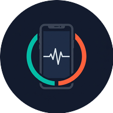
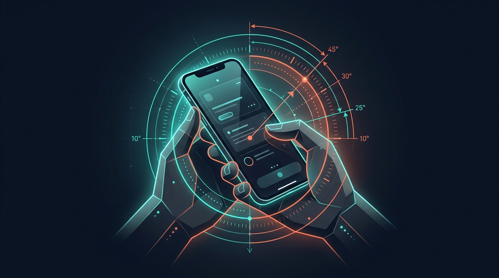

<div align="center">
  

  <h1>GripPulse</h1>
  <p>
    <strong>Real-time daily smartphone hand-hold &amp; grip ergonomics telemetry for Android</strong><br />
    Built with Jetpack Compose, Google Material 3 Expressive, Adaptive Multi-Axis Pattern Learning, and Live Home Screen Widgets.
  </p>

  <p>
    
    
    
    
    
  </p>
</div>

<p align="center">
  
</p>

---

## Overview

**GripPulse** uses your phone's real hardware sensors (`Gravity` / `Accelerometer`, `Gyroscope`, and `Proximity`) to measure **how long you hold your phone in each hand every day** and **which grip posture you rely on most frequently**.

Unlike static one-size-fits-all tilt scripts, GripPulse combines **pitch-independent YZ-plane orientation math** with an **on-device adaptive pattern-learning engine** that learns your personal hand geometry from calibration captures, one-tap live corrections, and steady daily holds—continuously improving accuracy over time.

---

## Screenshots

<div align="center">
  <table>
    <tr>
      <th align="center">Today Dashboard</th>
      <th align="center">Grip Patterns &amp; History</th>
      <th align="center">Home Screen Widgets</th>
      <th align="center">Adaptive Calibration</th>
    </tr>
    <tr>
      <td align="center">
        
      </td>
      <td align="center">
        
      </td>
      <td align="center">
        
      </td>
      <td align="center">
        
      </td>
    </tr>
  </table>
</div>

> **Capturing Real In-App Screenshots via ADB**
> Connect a device or emulator with GripPulse installed and run the included helper script:
> ```bash
> bash scripts/capture_screenshots.sh
> ```
> Or capture each screen manually with ADB:
> ```bash
> mkdir -p docs/screenshots
> adb exec-out screencap -p > docs/screenshots/dashboard.png
> adb exec-out screencap -p > docs/screenshots/grips.png
> adb exec-out screencap -p > docs/screenshots/widgets.png
> adb exec-out screencap -p > docs/screenshots/calibrate.png
> ```

---

## Key Features

### 1. Real-Time Hand & Grip Telemetry
- **Hand Hold Breakdown**: Measures daily duration and percentage share across **Left Hand**, **Right Hand**, and **Two Hands** (while automatically pausing accumulation when the phone is **Resting Flat** on a surface).
- **5 Classified Grip Types**:
  | Grip Type | Typical Posture | Ergonomic Load |
  | :--- | :--- | :--- |
  | **One-Hand Thumb** | Upright portrait with lateral wrist roll & single-thumb reach | Elevated Thumb Load |
  | **Two-Hand Typing** | Balanced bilateral portrait hold with level roll & low variance | Low Strain |
  | **Cradle & Index** | Flatter palm cradle (`12°–38°` pitch) with low rotational jitter | Low Strain |
  | **Landscape Hold** | Bilateral sideways hold for media or gaming | Moderate |
  | **Upright / Call** | Steep vertical angle (`≥ 78°`) or near proximity sensor | Moderate |
- **Live Gyroscopic HUD**: Interactive Compose `Canvas` tilt gauge updating in real time with Roll, Pitch, and Stability readouts.
- **24-Hour Hand Rhythm & 7-Day History**: Stacked hourly bar chart, hand-switch counter, Balance Score (`0–100`), and multi-day history selector.

### 2. Adaptive Pattern-Learning Engine & Fixed Calibration
- **Pitch-Independent Physics**: Computes lateral roll via `atan2(nx, hypot(ny, nz))` rather than `atan2(nx, nz)`, eliminating gimbal blow-up when holding the phone upright at `75°–90°`.
- **On-Device Weighted k-NN + Gaussian Prototype Model**:
  - Stores 6-axis sensor fingerprints `(nx, ny, nz, rollDeg, pitchDeg, gyroMag, rollSpreadDeg)` in Room (`grip_pattern_samples`).
  - **One-Tap Live Teaching**: Tap `Left`, `Right`, or `2-Hand` directly inside the live hero card to teach your exact natural tilt instantly (`3.5x` weight).
  - **2.2-Second Multi-Axis Calibration**: Guided capture records mean gravity vector, roll/pitch clusters, and natural hand micro-motion spread (`3.0x` weight).
  - **Continuous Self-Improvement**: Once anchored, steady high-confidence holds automatically refine your personal clusters over time with recency decay.
- **AI Pattern Study Layer (`GripAiAdvisor`)**: Clean single-interface architecture ready for cloud Gemini coaching via Firebase AI Logic (currently runs in local placeholder preview mode with an in-app notice until Firebase is enabled).

### 3. Real-Time Home Screen Widgets
- **Compact Live Widget (`2×2`)**: Live active hand, current grip type, today's total hold time, `L / R / 2H` split, and top grip badge.
- **Daily Insights Widget (`4×2`)**: Live status header, color-coded progress bars for Left / Right / Two-Handed durations & shares, **Top Grip** spotlight card, and a direct home-screen **Start / Live** background tracking toggle.
- **One-Tap Pinning**: Preview both live-synced widgets in the **Widgets** tab and pin them directly via `AppWidgetManager.requestPinAppWidget()`.

### 4. Google Material 3 Expressive UI + Floating Liquid Glass Pill
- Built on official Google **Material 3 Expressive** packages (`androidx.compose.material3:material3:1.5.0-alpha09` & `androidx.graphics:graphics-shapes:1.0.1`):
  - `MaterialExpressiveTheme` with `MotionScheme.expressive()`
  - `MaterialShapes` (`Cookie9Sided`, `SoftBurst`, `Clover4Leaf`)
  - Animated `LinearWavyProgressIndicator` bars
  - Shape-morphing `LoadingIndicator` & `ContainedLoadingIndicator`
- **Floating Liquid Glass Pill Navigation Bar**: Multi-layered frosted glass capsule with specular highlight sheen, ambient tab-tinted glow, spring-bouncing sliding droplet indicator, adaptive tablet rail, and safe `navigationBarsPadding()`.
- **Custom Bundled Typography**: `Space Grotesk`, `Plus Jakarta Sans`, and `JetBrains Mono`.

---

## Architecture & Project Structure

```text
app/src/main/java/com/example/
├── GripPulseApp.kt                  # Singleton DI container (Room, DataStore, SensorEngine, AI Advisor)
├── MainActivity.kt                  # Edge-to-edge Activity + foreground sensor lifecycle hooks
├── ai/
│   └── GripAiAdvisor.kt             # Single AI pattern study interface + placeholder preview advisor
├── data/
│   ├── GripDatabase.kt              # Room DB v2 (telemetry segments + learned pattern samples)
│   ├── GripDao.kt                   # Reactive Flow queries & rolling auto-learned sample pruning
│   ├── GripSegmentEntity.kt         # Recorded hand/grip hold intervals
│   ├── GripPatternSampleEntity.kt   # 6-axis sensor fingerprints for adaptive learning
│   ├── GripPreferencesRepository.kt # DataStore settings & fast SharedPreferences widget cache
│   └── GripRepository.kt            # Daily summaries, 24h rhythm, 7-day history, pattern persistence
├── model/
│   └── GripModels.kt                # HandType, GripType, CalibrationProfile, AdaptiveModelStats, UI models
├── sensor/
│   ├── AdaptiveGripModel.kt         # On-device weighted k-NN + Gaussian prototype learner
│   ├── GripClassifier.kt            # Pitch-independent YZ-plane physics + adaptive fusion classifier
│   ├── GripSensorEngine.kt          # Hardware SensorManager fusion, smoothing, live capture & widget push
│   └── GripTrackingService.kt       # specialUse Foreground Service for 24/7 background tracking
├── widget/
│   ├── GripCompactWidgetProvider.kt # 2x2 Real-time home screen widget provider
│   ├── GripInsightsWidgetProvider.kt# 4x2 Detailed daily insights widget provider
│   └── GripWidgetUpdater.kt         # RemoteViews renderer & interactive PendingIntents
└── ui/
    ├── GripPulseViewModel.kt        # Unidirectional StateFlow MVVM state manager
    ├── GripPulseRoot.kt             # Navigation Compose host + atmospheric ambient glow + Liquid Glass bar
    ├── components/
    │   ├── LiquidGlassNavBar.kt     # Floating Liquid Glass pill bottom bar & tablet rail
    │   └── TelemetryVisuals.kt      # Custom Canvas tilt gauge, donut split ring & 24h stacked bar chart
    ├── screens/
    │   ├── DashboardScreen.kt       # Today live HUD, 1-tap teaching, bento metrics & split charts
    │   ├── GripsScreen.kt           # 7-day history strip, ranked grip cards & recent hold log
    │   ├── WidgetsScreen.kt         # Live widget previews, 1-tap pinning & sync engine controls
    │   └── CalibrateScreen.kt       # Adaptive model maturity, AI study, multi-axis capture & raw sensor feed
    └── theme/
        ├── Color.kt                 # Obsidian & Alabaster precision studio color tokens
        ├── Theme.kt                 # MaterialExpressiveTheme + MotionScheme.expressive()
        └── Type.kt                  # Space Grotesk, Plus Jakarta Sans & JetBrains Mono scale
```

---

## Tech Stack

| Layer | Technology |
| :--- | :--- |
| **Language** | Kotlin 2.4 + Coroutines & `StateFlow` |
| **UI Framework** | Jetpack Compose (`compose-bom:2025.12.00`) |
| **Design System** | Google Material 3 Expressive (`material3:1.5.0-alpha09`, `graphics-shapes:1.0.1`) |
| **Navigation** | Navigation Compose (`navigation-compose:2.8.9`) |
| **Local Persistence** | Room (`2.7.0` with KSP) + Preferences DataStore (`1.1.7`) |
| **Sensors & Background** | Android `SensorManager`, Foreground Service (`specialUse`), `AppWidgetProvider` |
| **Testing** | JUnit 4 (`GripClassifierTest` verifying pitch-independent physics & adaptive learning) |

---

## Getting Started

### Prerequisites
- Android Studio Ladybug / Narwhal or newer
- JDK 11+
- Android device or emulator running API 24+ (physical device recommended for real accelerometer & gyroscope dynamics)

### Build & Run
```bash
# Compile debug APK
./gradlew :app:assembleDebug

# Run unit tests (physics & adaptive pattern learning tests)
./gradlew :app:testDebugUnitTest --tests com.example.GripClassifierTest
```

### Adding Home Screen Widgets
1. Open **GripPulse** and navigate to the **Widgets** tab.
2. Tap **Pin Compact Widget to Home Screen** (`2×2`) or **Pin Daily Insights Widget (4×2)**, or long-press your launcher home screen → **Widgets → GripPulse**.
3. Enable **Background Telemetry Service** (`LIVE BG`) so both widgets refresh automatically whenever your hand or grip changes.

---

## Permissions & Privacy

- **100% On-Device Telemetry**: All daily hold statistics, grip logs, and adaptive sensor patterns remain strictly on your device in local Room and DataStore storage.
- **Minimal Permissions**:
  - `FOREGROUND_SERVICE` & `FOREGROUND_SERVICE_SPECIAL_USE`: Optional background sensor tracking for real-time home screen widget updates.
  - `POST_NOTIFICATIONS` (Android 13+ runtime prompt): Displays the ongoing live hand/grip tracking status notification when background mode is active.
